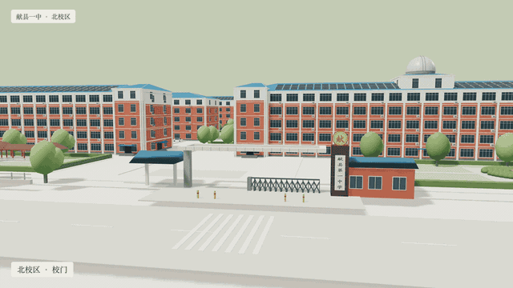
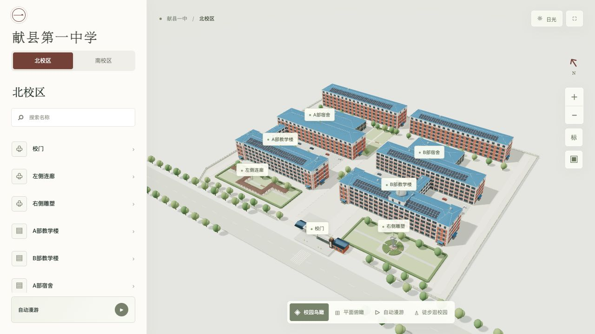
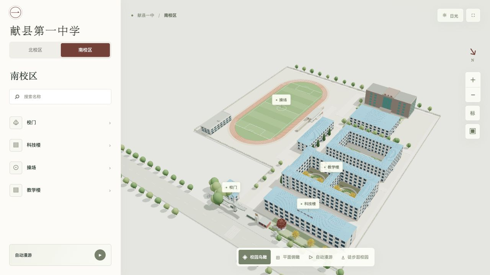

<h1 align="center">Xianxian Campus · 献县第一中学三维校园</h1>
<h4 align="center"><b>JavaScript + Three.js · 双校区漫游与校服小人徒步</b></h4>

<p align="center">
  <a href="https://neverwinhao.github.io/xxyz/"></a>
  <a href="docs/MODELING.md"></a>
  <a href="https://threejs.org/"></a>
  <a href="https://github.com/neverwinHao/xianxian-campus/actions/workflows/check.yml"></a>
</p>

<a id="demo"></a>

<p align="center">
  <a href="https://neverwinhao.github.io/xxyz/"></a>
</p>

<table>
  <tr>
    <th align="center">北校区</th>
    <th align="center">南校区</th>
  </tr>
  <tr>
    <td width="50%"><a href="https://neverwinhao.github.io/xxyz/#north"></a></td>
    <td width="50%"><a href="https://neverwinhao.github.io/xxyz/#south"></a></td>
  </tr>
</table>

**用代码重建记忆中的校园。** 本项目根据航拍、照片和建筑位置指认，以 JavaScript 参数化构建献县一中南北校区。楼体、屋顶、门窗、道路、树木、雕塑和校服小人都在浏览器中生成，支持自动漫游与自由徒步。点击动图即可在线体验，静态预览可直达对应校区。

<a id="features"></a>

## 🏫 校园展示

- **北校区**：校门、左侧连廊、右侧雕塑、A/B 部教学楼、A/B 部宿舍、A/B 部食堂。
- **南校区**：校门、科技楼、操场、教学楼；后方宿舍、食堂等楼体保留在模型中。
- **自动漫游**：首次打开即开始，支持建筑定位、近景、鸟瞰、俯视、日光切换和截图。
- **校服小人**：电脑键盘或手机摇杆控制，包含行走动画、建筑碰撞、校园边界与跟随镜头；可在蓝色、绿色两套校服之间换装。

<a id="modeling"></a>

## 🧭 建模流程


**先校对布局，再搭建体量，最后补充细节。** `campuses.js` 描述建筑位置和尺寸，`scene.js` 生成楼体、窗组、坡顶及景观，`walk.js` 负责校服角色与导航。重复构件通过实例化绘制，校名和胸徽由 Canvas 生成。

项目没有使用 Blender 建模，也不依赖 `.blend`、`.glb` 或实景照片贴图。照片仅用于人工判断，尺寸与不可见细节为近似；仓库中的预览图均为模型渲染结果。完整步骤和修改示例见 [建模过程](docs/MODELING.md)，接口与交互见 [项目结构](docs/ARCHITECTURE.md)。

<a id="quick-start"></a>

## 🚀 快速开始

[](package.json)

使用 Node.js 20 或更新版本：

```bash
git clone https://github.com/neverwinHao/xianxian-campus.git
cd xianxian-campus
npm start
```

打开 <http://127.0.0.1:5173/>。项目没有 npm 依赖，无需执行 `npm install`；Three.js r146 与 OrbitControls 已保存在 `vendor/three/`。也可以直接用现代浏览器打开根目录的 `index.html`。

<a id="controls"></a>

## 🎮 操作方式

| 场景 | 操作 |
| --- | --- |
| 浏览校园 | 鼠标旋转、缩放、平移；点击名称定位建筑 |
| 自动漫游 | 点击“自动漫游”；手动操作相机或切换校区可结束当前漫游 |
| 电脑徒步 | 点击“徒步逛校园”，使用 WASD / 方向键移动，Shift 快走 |
| 手机徒步 | 使用屏幕摇杆移动，拖动调整视角，点击“快走”切换速度 |
| 返回入口 | 徒步模式下点击“回到校门” |
| 换校服 | 徒步模式下点击顶部的蓝色或绿色圆点 |

<a id="build"></a>

## 📦 打包与部署

```bash
npm run build
```

生成 `dist/index.html` 和 `dist/THREE-LICENSE.txt`。HTML 内联全部模型代码与样式，可独立打开；将 `dist/` 内容复制到 GitHub Pages 或其他静态托管目录即可部署。

当前 [在线体验](https://neverwinhao.github.io/xxyz/) 由独立站点仓库维护。访问计数仅在该线上地址启用，本地和离线版本不发送统计请求；更换部署地址时可在 `src/visits.js` 中调整条件。

<a id="repository-layout"></a>

## 📂 仓库结构

| 文件 / 目录 | 用途 |
| --- | --- |
| [index.html](index.html) | 页面入口 |
| [src/campuses.js](src/campuses.js) | 校区坐标、建筑参数、名称与漫游路线 |
| [src/scene.js](src/scene.js) | 几何构建、材质、实例化、光照与相机 |
| [src/walk.js](src/walk.js) | 校服小人、键盘 / 触摸输入、碰撞与跟随镜头 |
| [src/app.js](src/app.js) | 页面状态、地点选择、漫游与校区切换 |
| [src/style.css](src/style.css)、[src/visits.js](src/visits.js) | 页面样式与可选访问计数 |
| [vendor/three/](vendor/three/) | 本地 Three.js、OrbitControls 及 MIT 许可证 |
| [tools/](tools/) | 开发服务、语法检查与单文件打包 |
| [tests/](tests/)、[docs/](docs/) | 步行测试、建模说明与预览图 |

<a id="development"></a>

## 🧪 开发与验证

```bash
npm run check  # JavaScript 语法检查
npm test       # 步行、碰撞和跟随镜头测试
npm run build  # 验证并生成单文件页面
```

调整建筑位置、尺寸和用途，从 `src/campuses.js` 开始；改变立面、屋顶或雕塑形状，修改 `src/scene.js` 中的构建函数；更换校服或移动规则，修改 `src/walk.js`。导航测试覆盖角色移动、建筑碰撞、校园边界与镜头遮挡。

## 🙏 致谢

感谢 [Three.js](https://threejs.org/) 及 OrbitControls 的作者与贡献者。本项目使用的本地库来自 [SDU-Qingdao-Campus](https://github.com/lijihao-0804/SDU-Qingdao-Campus) 的查看器目录；献县校园的几何由本仓库的 JavaScript 生成。感谢提供航拍、建筑照片、校服参考和位置校对的人。

第三方来源与许可证见 [THIRD_PARTY_NOTICES.md](THIRD_PARTY_NOTICES.md)。
